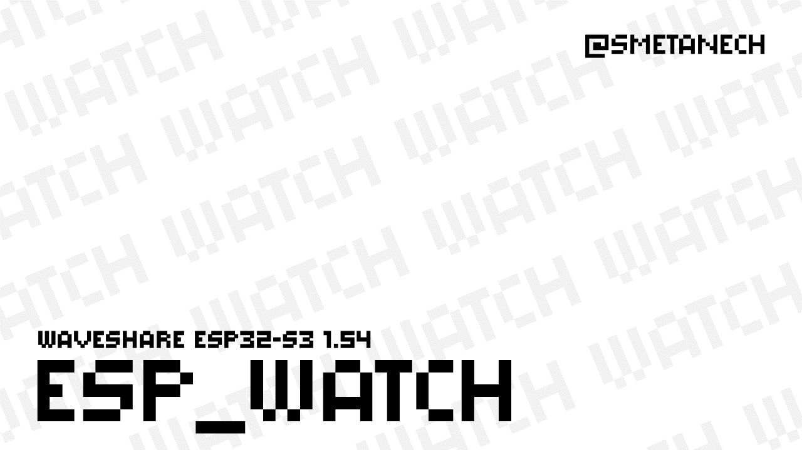
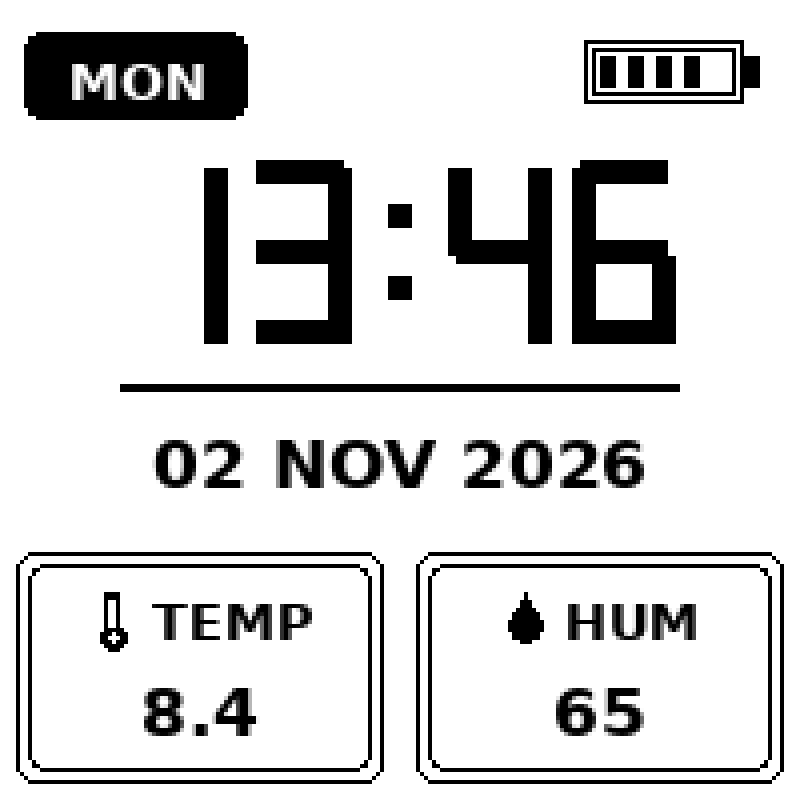
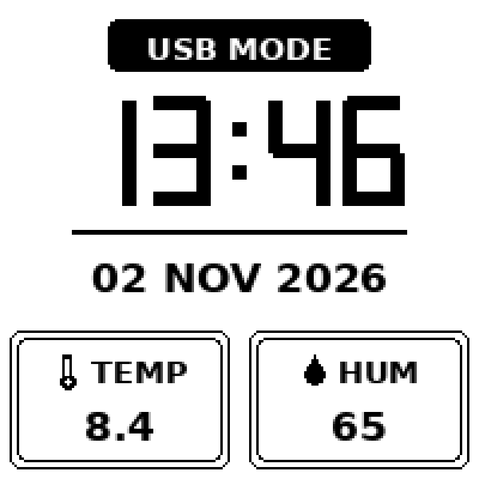

# ESP32-S3 Pocket Watch & Weather

> **This firmware is written specifically for the [Waveshare ESP32-S3 e-Paper 1.54](https://www.waveshare.com/esp32-s3-epaper-1.54.htm) board.** The pinout, display driver, power rails and button logic are matched to this exact hardware — keep this in mind before using any other board.



A pocket e-paper clock and weather station built on the ESP32-S3: large seven-segment time, day of the week, date, temperature and humidity from the SHTC3, and a battery indicator — all on a 1.54" 200×200 e-paper panel. The device sleeps almost all the time and wakes up once per update interval, so it runs for days on a small Li-Po cell.

## Components

| Board | Manufacturer |
|---|---|
| [Waveshare ESP32-S3 e-Paper 1.54](https://www.waveshare.com/esp32-s3-epaper-1.54.htm) | Waveshare |

All subsequent code is written specifically for this board: the display wiring, power-control pins, I²C bus and button are hard-matched to its schematics. Additional information about the board — original examples, driver functions and documentation — can be found in the manufacturer's repository: [github.com/waveshareteam/ESP32-S3-ePaper-1.54](https://github.com/waveshareteam/ESP32-S3-ePaper-1.54).

## Features

- 200×200 e-paper screen, fully procedural UI (no bitmap assets)
- Real time from the on-board PCF85063A RTC, temperature & humidity from SHTC3
- Deep sleep between updates, NTP time sync every `NTP_SYNC_MINUTES`
- Battery gauge from ADC with averaging and a clamped 3.1–4.2 V range
- **USB mode**: keep the device awake for flashing and charging, entered and exited with the same button
- Fixed display year (`DISPLAY_YEAR` in `config.h`) — the RTC stores only two year digits, so the year is set explicitly

## How it works

The total cycle is `UPDATE_INTERVAL_SECONDS` seconds: the device wakes up, reads the RTC and SHTC3, measures the battery with 8 averaged ADC samples, redraws the full screen, and goes back to deep sleep for `UPDATE_INTERVAL_SECONDS - ACTIVE_WINDOW_SECONDS`.

### USB mode

Holding the button (`BTN_POWER`, configurable in `config.h`, default BOOT/GPIO0) for 3 seconds switches the device into **USB mode**: it stops sleeping, keeps the screen alive (with a `USB MODE` banner instead of the day plate and battery icon) and stays connected to the PC — convenient for flashing and charging. Holding the same button again for `USB_EXIT_HOLD_MS` (1.5 s by default) exits USB mode: the banner disappears and the device resumes its normal sleep-cycle operation.

Additionally:

- holding the button while powering the device on enters USB mode immediately;
- a short press wakes the device from deep sleep (`ext0` wakeup on the button pin);
- inside USB mode the screen keeps refreshing on the same schedule, and NTP sync still runs on schedule.

## Graphics





| Element | Purpose |
|---|---|
| Day plate (MON…SUN) | Day of the week, from the RTC |
| Battery icon (top right) | 5-segment gauge, 3.1–4.2 V mapped by `map()` |
| Large digits (center) | Time, procedural seven-segment rendering |
| Separator line | Visual divider between time and date |
| Date (center) | `DD MMM YYYY`, year fixed via `DISPLAY_YEAR` |
| TEMP / HUM cards | Sensor values; `--` is shown if SHTC3 fails |
| USB MODE banner | Shown only in USB mode, replaces day plate + battery |

## Build & Flash (Arduino IDE)

Board settings:

| Setting | Value |
|---|---|
| Board | ESP32S3 Dev Module |
| Port | COM5 (choose yours) |
| USB CDC On Boot | Enabled |
| CPU Frequency | 240MHz (WiFi) |
| Flash Mode | QIO 80MHz |
| Flash Size | 4MB (32Mb) |
| Partition Scheme | Huge APP (3MB No OTA/1MB SPIFFS) |
| PSRAM | OPI PSRAM |
| Upload Speed | 921600 |

Step by step:

1. Install the Arduino IDE (1.8.19 or 2.x).
2. Add the ESP32 core: File → Preferences → Additional Board Manager URLs → `https://espressif.github.io/arduino-esp32/package_esp32_index.json`, then Tools → Board Manager → install **esp32 by Espressif Systems**.
3. Install libraries via Library Manager: **GxEPD2**, **Adafruit SHTC3 Library**, **Adafruit BusIO**. Install **PCF85063A-SOLDERED** from the Soldered Electronics GitHub if it is not in Library Manager.
4. Copy the sketch folder `ESP32_S3_PocketWeather` anywhere — the folder name must match the `.ino` name.
5. Copy `config.example.h` to `config.h` and fill in your Wi-Fi SSID/password and timezone.
6. Connect the board with a USB-C cable; the port appears as COMx (Windows) or /dev/ttyACMx (Linux/macOS).
7. Select the board settings from the table above (choose your actual port).
8. Press Upload. If the console hangs at "Connecting...", hold the BOOT button on the board until flashing starts, then release.
9. Open Serial Monitor at 115200 baud: after each wake-up you should see the RTC readout and the update cycle.
10. To flash a device that sleeps most of the time, enter **USB mode** first (hold the button for 3 s) — the MCU will not fall asleep mid-upload.

### PlatformIO (alternative)

```
pio run -t upload
```

`platformio.ini` is included; all dependencies are pulled automatically.

## Configuration

| Parameter | Default | Description |
|---|---|---|
| `WIFI_SSID` / `WIFI_PASS` | — | Wi-Fi credentials |
| `NTP_SERVER` | `pool.ntp.org` | NTP server |
| `TZ_INFO` | `VLAT-10` | POSIX timezone (Vladivostok, UTC+10) |
| `NTP_SYNC_MINUTES` | 30 | NTP sync interval, minutes |
| `WIFI_TIMEOUT_MS` | 10000 | Wi-Fi connect timeout, ms |
| `UPDATE_INTERVAL_SECONDS` | 60 | Total time between updates |
| `ACTIVE_WINDOW_SECONDS` | 10 | Time awake per cycle (button window) |
| `DISPLAY_YEAR` | 2026 | Fixed year shown on the display |
| `BTN_POWER` | 0 | USB-mode button GPIO |
| `USB_EXIT_HOLD_MS` | 1500 | Hold time to leave USB mode, ms |
| `EPD_KEEP_POWERED_DURING_SLEEP` | 1 | 1 = keep display rail on during sleep |
| `SPI_CLOCK_HZ` | 4000000 | e-paper SPI speed |

## Usage

### Controls

| Action | Result |
|---|---|
| Hold button 3 s while awake | Enter USB mode |
| Hold button 1.5 s in USB mode | Exit USB mode, resume normal cycle |
| Hold button while powering on | Enter USB mode immediately |
| Short press while asleep | Wake the device |

### Behavior

- The device wakes, updates and sleeps automatically — no interaction required.
- If the SHTC3 fails, the cards show `--` instead of garbage values.
- The battery gauge is clamped to 3.1–4.2 V, so segments never overflow the icon.
- Charge the battery or flash the firmware conveniently in USB mode.

## Power budget

Measured/estimated currents: ~45 mA active, ~20 µA deep sleep, ~95 mA during the Wi-Fi/NTP burst (12 s every 30 minutes).

Average current:

```
I_avg = (I_active × t_active + I_sleep × t_sleep) / cycle
      + (I_wifi × t_wifi) / 1800 s
```

For `UPDATE_INTERVAL_SECONDS = 60`: `I_avg = (45 mA × 10 s + 0.02 mA × 50 s) / 60 + 95 mA × 12 s / 1800 s ≈ 8.15 mA`.

For `UPDATE_INTERVAL_SECONDS = 300`: `I_avg ≈ 2.15 mA`.

Runtime ≈ capacity / I_avg:

| Battery | 60 s cycle (≈8.15 mA) | 300 s cycle (≈2.15 mA) |
|---|---|---|
| 300 mAh | ~1.5 days | ~5.8 days |
| 400 mAh | ~2.0 days | ~7.8 days |
| 500 mAh | ~2.6 days | ~9.7 days |
| 1000 mAh | ~5.1 days | ~19.4 days |

In USB mode (no sleep, ~45 mA) a 300 mAh cell lasts about 6.7 hours — enough for a flashing and charging session.

## Troubleshooting

- **Display stays blank** — check `EPD_PWR` wiring and that the panel connector is seated.
- **No NTP sync** — verify Wi-Fi credentials and that the network reaches the internet; the RTC keeps time meanwhile.
- **`--` on the cards** — SHTC3 not answering: check the I²C wiring (SDA 47, SCL 48).
- **Upload fails** — hold BOOT while the console prints "Connecting...".
- **Wrong date year** — the year is fixed by design (`DISPLAY_YEAR`); the RTC hardware only stores two digits.

## License

MIT — see [LICENSE](LICENSE).
