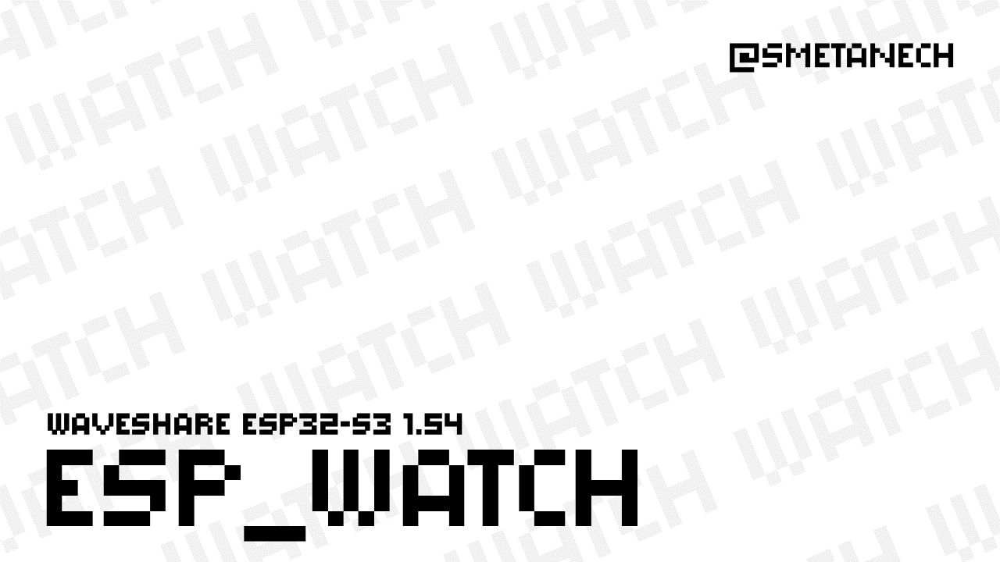
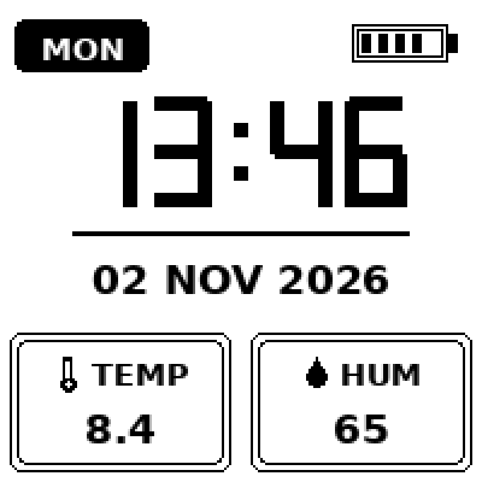
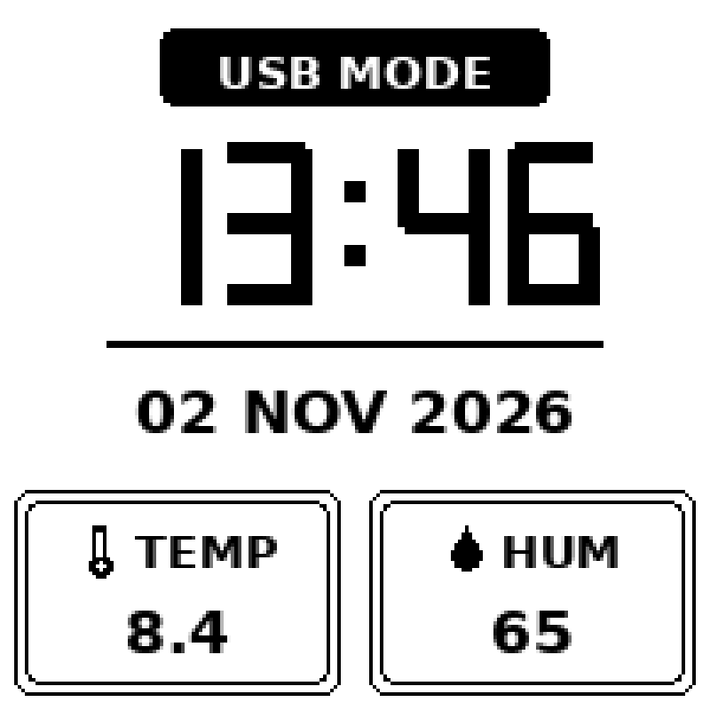

# ESP32-S3 Pocket Watch & Weather

> **Эта прошивка написана специально под плату [Waveshare ESP32-S3 e-Paper 1.54](https://www.waveshare.com/esp32-s3-epaper-1.54.htm).** Распиновка, драйвер дисплея, цепи питания и логика кнопки подобраны именно под это железо — учитывайте это перед использованием других плат.



Карманные часы-метеостанция на ESP32-S3 с экраном на электронных чернилах: крупное семисегментное время, день недели, дата, температура и влажность с SHTC3 и индикатор батареи — всё на панели 1.54" 200×200. Устройство почти всё время спит и просыпается раз в интервал обновления, поэтому работает на небольшом Li-Po аккумуляторе неделями.

## Компоненты

| Плата | Производитель |
|---|---|
| [Waveshare ESP32-S3 e-Paper 1.54](https://www.waveshare.com/esp32-s3-epaper-1.54.htm) | Waveshare |

Весь последующий код написан именно под эту плату: подключение дисплея, пины питания, шина I²C и кнопка жестко привязаны к её схемотехнике. Дополнительную информацию о плате — оригинальные примеры работы с функциями дисплея и документацию — можно найти в репозитории производителя: [github.com/waveshareteam/ESP32-S3-ePaper-1.54](https://github.com/waveshareteam/ESP32-S3-ePaper-1.54).

## Возможности

- Экран 200×200 на электронных чернилах, полностью процедурный интерфейс (без битмапов)
- Точное время с RTC PCF85063A, температура и влажность с SHTC3
- Глубокий сон между обновлениями, синхронизация NTP каждые `NTP_SYNC_MINUTES` минут
- Индикатор батареи по АЦП с усреднением и ограничением диапазона 3.1–4.2 В
- **USB-режим**: устройство не засыпает для прошивки и зарядки, вход и выход одной кнопкой
- Фиксированный год на экране (`DISPLAY_YEAR` в `config.h`) — RTC хранит только две цифры года, поэтому он задается явно

## Как это работает

Полный цикл длится `UPDATE_INTERVAL_SECONDS` секунд: устройство просыпается, читает RTC и SHTC3, меряет батарею 8 усредненными замерами АЦП, перерисовывает экран и снова уходит в глубокий сон на `UPDATE_INTERVAL_SECONDS - ACTIVE_WINDOW_SECONDS`.

### USB-режим

Удержание кнопки (`BTN_POWER`, настраивается в `config.h`, по умолчанию BOOT/GPIO0) в течение 3 секунд переводит устройство в **USB-режим**: оно перестает засыпать, держит экран активным (вместо плашки дня и батарейки появляется баннер `USB MODE`) и остается подключенным к ПК — удобно для прошивки и зарядки. Повторное удержание той же кнопки в течение `USB_EXIT_HOLD_MS` (по умолчанию 1.5 с) выводит из USB-режима: баннер пропадает, устройство возвращается к обычной работе с периодическими выключениями.

Кроме того:

- удержание кнопки при включении питания сразу переводит устройство в USB-режим;
- короткое нажатие будит устройство из глубокого сна (`ext0` по пину кнопки);
- в USB-режиме экран продолжает обновляться по обычному расписанию, NTP-синхронизация тоже работает по расписанию.

## Графика





| Элемент | Назначение |
|---|---|
| Плашка дня (MON…SUN) | День недели, берется из RTC |
| Батарейка (справа сверху) | Индикатор из 5 сегментов, диапазон 3.1–4.2 В через `map()` |
| Крупные цифры (центр) | Время, процедурная семисегментная отрисовка |
| Разделительная линия | Визуальный разделитель между временем и датой |
| Дата (центр) | `ДД МЕС ГГГГ`, год фиксирован через `DISPLAY_YEAR` |
| Карточки TEMP / HUM | Показания датчика; при сбое SHTC3 выводится `--` |
| Баннер USB MODE | Только в USB-режиме, заменяет плашку дня и батарейку |

## Сборка и прошивка (Arduino IDE)

Настройки платы:

| Настройка | Значение |
|---|---|
| Board | ESP32S3 Dev Module |
| Port | COM5 (выберите ваш) |
| USB CDC On Boot | Enabled |
| CPU Frequency | 240MHz (WiFi) |
| Flash Mode | QIO 80MHz |
| Flash Size | 4MB (32Mb) |
| Partition Scheme | Huge APP (3MB No OTA/1MB SPIFFS) |
| PSRAM | OPI PSRAM |
| Upload Speed | 921600 |

Пошагово:

1. Установите Arduino IDE (1.8.19 или 2.x).
2. Добавьте ядро ESP32: File → Preferences → Additional Board Manager URLs → `https://espressif.github.io/arduino-esp32/package_esp32_index.json`, затем Tools → Board Manager → установите **esp32 by Espressif Systems**.
3. Установите библиотеки через Library Manager: **GxEPD2**, **Adafruit SHTC3 Library**, **Adafruit BusIO**. Библиотеку **PCF85063A-SOLDERED** при отсутствии в Library Manager установите из GitHub Soldered Electronics.
4. Скопируйте папку скетча `ESP32_S3_PocketWeather` куда угодно — имя папки должно совпадать с именем `.ino`.
5. Скопируйте `config.example.h` в `config.h` и впишите свои Wi-Fi SSID/пароль и таймзону.
6. Подключите плату кабелем USB-C; порт появится как COMx (Windows) или /dev/ttyACMx (Linux/macOS).
7. Выберите настройки платы из таблицы выше (порт — ваш фактический).
8. Нажмите Upload. Если консоль зависает на «Connecting...», зажмите кнопку BOOT на плате до начала прошивки и отпустите.
9. Откройте Serial Monitor на 115200 бод: после каждого пробуждения вы увидите чтение RTC и цикл обновления.
10. Чтобы прошить устройство, которое почти всегда спит, сначала войдите в **USB-режим** (удерживайте кнопку 3 с) — микроконтроллер не уснет посреди загрузки.

### PlatformIO (альтернатива)

```
pio run -t upload
```

`platformio.ini` прилагается, все зависимости подтянутся автоматически.

## Настройка

| Параметр | По умолчанию | Описание |
|---|---|---|
| `WIFI_SSID` / `WIFI_PASS` | — | Данные Wi-Fi |
| `NTP_SERVER` | `pool.ntp.org` | NTP-сервер |
| `TZ_INFO` | `VLAT-10` | Таймзона в формате POSIX (Владивосток, UTC+10) |
| `NTP_SYNC_MINUTES` | 30 | Интервал синхронизации NTP, минут |
| `WIFI_TIMEOUT_MS` | 10000 | Таймаут подключения Wi-Fi, мс |
| `UPDATE_INTERVAL_SECONDS` | 60 | Полное время между обновлениями |
| `ACTIVE_WINDOW_SECONDS` | 10 | Время бодрствования за цикл (окно для кнопки) |
| `DISPLAY_YEAR` | 2026 | Фиксированный год на дисплее |
| `BTN_POWER` | 0 | GPIO кнопки USB-режима |
| `USB_EXIT_HOLD_MS` | 1500 | Время удержания для выхода из USB-режима, мс |
| `EPD_KEEP_POWERED_DURING_SLEEP` | 1 | 1 = держать питание дисплея во сне |
| `SPI_CLOCK_HZ` | 4000000 | Скорость SPI дисплея |

## Работа

### Управление

| Действие | Результат |
|---|---|
| Удерживать кнопку 3 с в обычном режиме | Вход в USB-режим |
| Удерживать кнопку 1.5 с в USB-режиме | Выход из USB-режима, возврат к обычному циклу |
| Удерживать кнопку при включении питания | Сразу войти в USB-режим |
| Короткое нажатие во сне | Разбудить устройство |

### Поведение

- Устройство само просыпается, обновляется и засыпает — участия не требует.
- При сбое SHTC3 на карточках выводится `--` вместо мусорных значений.
- Индикатор батареи ограничен диапазоном 3.1–4.2 В, сегменты никогда не вылезут за иконку.
- Заряжать аккумулятор и прошивать удобно в USB-режиме.

## Энергобюджет

Измеренные/оценочные токи: ~45 мА в активной фазе, ~20 мкА в глубоком сне, ~95 мА при всплеске Wi-Fi/NTP (12 с раз в 30 минут).

Средний ток:

```
I_ср = (I_акт × t_акт + I_сон × t_сон) / цикл
     + (I_wifi × t_wifi) / 1800 с
```

Для `UPDATE_INTERVAL_SECONDS = 60`: `I_ср = (45 мА × 10 с + 0.02 мА × 50 с) / 60 + 95 мА × 12 с / 1800 с ≈ 8.15 мА`.

Для `UPDATE_INTERVAL_SECONDS = 300`: `I_ср ≈ 2.15 мА`.

Время работы ≈ ёмкость / I_ср:

| Аккумулятор | Цикл 60 с (≈8.15 мА) | Цикл 300 с (≈2.15 мА) |
|---|---|---|
| 300 мА·ч | ~1.5 дня | ~5.8 дня |
| 400 мА·ч | ~2.0 дня | ~7.8 дня |
| 500 мА·ч | ~2.6 дня | ~9.7 дня |
| 1000 мА·ч | ~5.1 дня | ~19.4 дня |

В USB-режиме (без сна, ~45 мА) банка 300 мА·ч продержится около 6.7 часов — достаточно для прошивки и подзарядки.

## Устранение неполадок

- **Экран пустой** — проверьте проводку `EPD_PWR` и что шлейф панели вставлен до конца.
- **Нет синхронизации NTP** — проверьте данные Wi-Fi и доступ сети в интернет; тем временем RTC хранит время.
- **`--` на карточках** — SHTC3 не отвечает: проверьте I²C-проводку (SDA 47, SCL 48).
- **Прошивка не заливается** — держите BOOT, пока консоль печатает «Connecting...».
- **Неправильный год** — так задумано (`DISPLAY_YEAR`): железо RTC хранит только две цифры года.

## Лицензия

MIT — см. [LICENSE](LICENSE).
